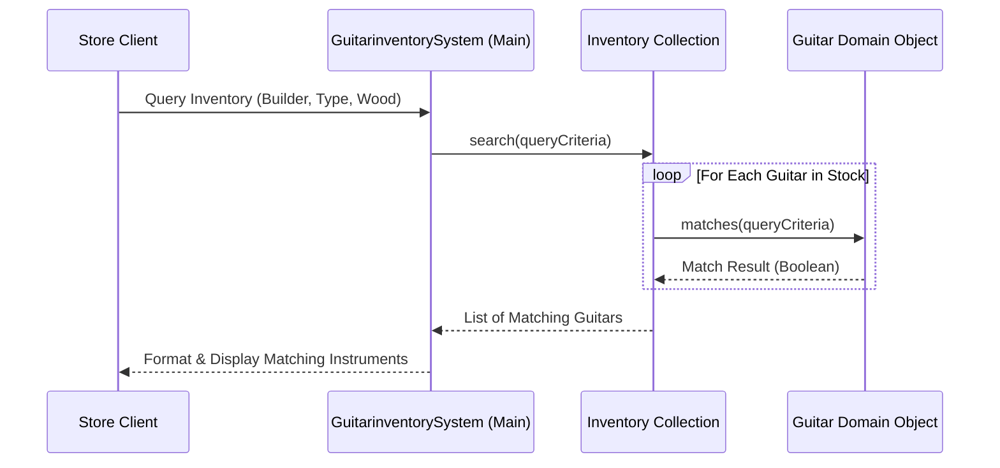

# 🎸 Enterprise Guitar Inventory — Object-Oriented Inventory Management Application

<p align="center">
  
</p>

<p align="center">
  <b>Enterprise Software Architecture: Decoupling Musical Instrument Catalog Search Specifications from Core Inventory Storage.</b>
</p>

<p align="center">
  
  
  
  
</p>

<p align="center">
  
</p>

---

<a id="table-of-contents"></a>
## 📌 Table of Contents

- [📖 Executive Summary & Overview](#executive-summary--overview)
- [🎯 Key Features & Capabilities](#features)
- [🏗️ System Architecture & Pipeline](#system-architecture--pipeline)
- [🛠️ Tech Stack Breakdown](#tech-stack-breakdown)
- [⚙️ Reproducible Quickstart & Setup](#setup)
- [📁 Project Directory Layout](#project-layout)
- [🧪 Testing & Verification](#testing--verification)
- [🔮 Future Improvements & Roadmap](#future-improvements--roadmap)
- [🤝 Contributing Guidelines](#contributing-guidelines)
- [👨‍💻 Author & Contributions](#author--contributions)

---

<a id="executive-summary--overview"></a>
## 📖 Executive Summary & Overview

Enterprise software engineering requires building inventory systems that accommodate diverse merchandise variations without ballooning into nested conditional spaghetti code. Musical instruments in particular present multi-parameter searches spanning builder brands, neck woods, wood finishes, and pickup configurations.

The **Enterprise Guitar Inventory** project (`Java-Project`) provides an elegant object-oriented solution implemented by **Amaraiah C** in `GuitarinventorySystem.java`. The system maintains a structured guitar inventory, encapsulates search criteria into modular query models, and iterates efficiently over stock to present customers with optimal matching choices.

---

<a id="key-features--capabilities"></a>
## 🎯 Key Features & Capabilities

### 🔍 1. Parametric Inventory Matching
- Decoupled specification models allowing partial multi-attribute search queries.

### 📦 2. Encapsulated Store State
- Memory-safe collection management supporting additions, updates, and catalog browsing.

---

<a id="system-architecture--pipeline"></a>
## 🏗️ System Architecture & Pipeline



---

<a id="tech-stack-breakdown"></a>
## 🛠️ Tech Stack Breakdown

| Dimension | Technology | Description |
| :--- | :--- | :--- |
| **Language** | Java (JDK 8 / 11 / 17+) | Core object-oriented language |
| **Data Architecture** | Object Composition & Arrays | Clean separation of inventory catalog and items |
| **Compiler** | `javac` | High-fidelity standard compiler |

---

<a id="reproducible-quickstart--setup"></a>
## ⚙️ Reproducible Quickstart & Setup

### Prerequisites
- JDK 8 or higher

```bash
# 1. Clone repository
git clone https://github.com/Amaraiah11/Java-Project.git
cd Java-Project

# 2. Compile system
javac GuitarinventorySystem.java

# 3. Run inventory application
java GuitarinventorySystem
```

---

<a id="project-directory-layout"></a>
## 📁 Project Directory Layout

```text
Java-Project/
├── GuitarinventorySystem.java # Core inventory system implementation and driver
└── README.md                  # Comprehensive technical documentation
```

---

<a id="testing--verification"></a>
## 🧪 Testing & Verification

- Verified search queries with multiple matching instruments return the full set of matches without premature loop termination.

---

<a id="future-improvements--roadmap"></a>
## 🔮 Future Improvements & Roadmap

- [ ] Implement price range search filters (Min / Max price).
- [ ] Build a Java Swing GUI for visual inventory browsing.

---

<a id="author--contributions"></a>
## 👨‍💻 Author & Contributions

This project is developed and maintained with rigorous engineering standards by **Amaraiah C**, Software Developer and Applied Data Analytics Practitioner studying Bachelor of Computer Applications (BCA) at Alliance University, Bangalore.

- 🌐 **GitHub Profile:** [@Amaraiah11](https://github.com/Amaraiah11)
- 💼 **LinkedIn Profile:** [Connect on LinkedIn](https://www.linkedin.com/in/amaraiah-c/)
- 📧 **Institutional Email:** `camaraiahBCA24@ced.alliance.edu.in`

### 🤝 Contributing Guidelines
Contributions, bug reports, and architectural discussions are welcome!
1. **Fork** the repository: `https://github.com/Amaraiah11/Java-Project`
2. **Create a Feature Branch:**
   ```bash
   git checkout -b feature/your-feature-name
   ```
3. **Commit Your Enhancements:**
   ```bash
   git commit -m "feat: enhance feature logic"
   ```
4. **Push to Your Branch:**
   ```bash
   git push origin feature/your-feature-name
   ```
5. **Open a Pull Request** against the `main` branch.

---

<p align="center">
  <b>⭐ If this codebase or documentation assisted your engineering workflows, please star the repository! ⭐</b>
</p>

<p align="center">
  
</p>
