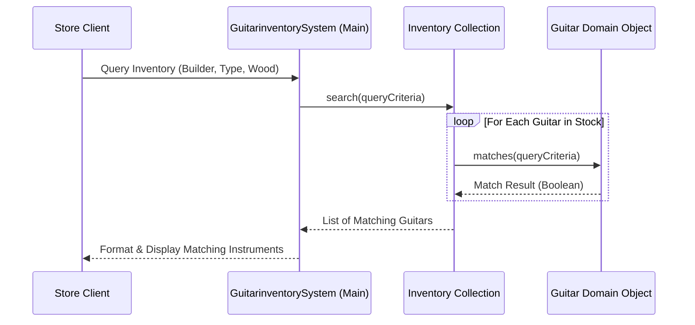

<p align="center">
  
</p>

<p align="center">
  
  
  
  
</p>

<a id="overview"></a>
## 📖 Executive Summary & Overview

Enterprise software engineering requires building inventory systems that accommodate diverse merchandise variations without ballooning into nested conditional spaghetti code. Musical instruments in particular present multi-parameter searches spanning builder brands, neck woods, wood finishes, and pickup configurations.

The **Enterprise Guitar Inventory** project (`Java-Project`) provides an elegant object-oriented solution in `GuitarinventorySystem.java`. The system maintains a structured guitar inventory, encapsulates search criteria into modular query models, and iterates efficiently over stock to present customers with optimal matching choices.

<a id="toc"></a>
## 📑 Table of Contents

- [📖 Executive Summary & Overview](#overview)
- [🎯 Key Features & Capabilities](#features)
- [🏗️ System Architecture & Pipeline](#architecture)
- [🛠️ Tech Stack Breakdown](#tech-stack)
- [⚙️ Reproducible Quickstart & Setup](#setup)
- [📁 Project Directory Layout](#project-layout)
- [👨‍💻 Author & Contributions](#author)

<a id="features"></a>
## 🎯 Key Features & Capabilities

- **Array-Backed Inventory Store:** Structured storage managing fixed and dynamic collections of guitar instances.
- **Parametric Search Matching:** Comparison algorithm matching client target criteria against inventory records.
- **Extensible Class Hierarchy:** Model attributes encompassing serial numbers, pricing, builder brands, and wood types.
- **Robust Client Driver:** Demonstration driver displaying sample inventory seeding and search querying.

<a id="architecture"></a>
## 🏗️ System Architecture & Pipeline



<a id="tech-stack"></a>
## 🛠️ Tech Stack Breakdown

| Dimension | Technology | Description |
| :--- | :--- | :--- |
| **Language** | Java (JDK 8 / 11 / 17+) | Core object-oriented language |
| **Data Architecture** | Object Composition & Arrays | Clean separation of inventory catalog and items |
| **Compiler** | `javac` | High-fidelity standard compiler |

<a id="setup"></a>
## ⚙️ Reproducible Quickstart & Setup

### Prerequisites
- JDK 8 or higher

```bash
# 1. Clone repository
git clone https://github.com/Amaraiah11/Java-Project.git
cd Java-Project

# 2. Compile system
javac GuitarinventorySystem.java

# 3. Run inventory application
java GuitarinventorySystem
```

<a id="project-layout"></a>
## 📁 Project Directory Layout

```text
Java-Project/
├── GuitarinventorySystem.java # Core inventory system implementation and driver
└── README.md                  # Comprehensive technical documentation
```

<a id="author"></a>
## 👨‍💻 Author & Contributions

This project is developed and maintained with high technical rigour by **Amaraiah C**, Software Engineer and Data Analytics Practitioner studying Bachelor of Computer Applications (BCA) at Alliance University.

- 🌐 **GitHub:** [@Amaraiah11](https://github.com/Amaraiah11)
- 💼 **LinkedIn:** [Connect on LinkedIn](https://www.linkedin.com/in/amaraiah-c/)
- 📧 **Institutional Contact:** `camaraiahBCA24@ced.alliance.edu.in`

### 🤝 Contribution Guidelines
Contributions, bug reports, and architectural discussions are welcome!
1. **Fork** the repository: `https://github.com/Amaraiah11/Java-Project`
2. **Branch**: `git checkout -b feature/your-feature-name`
3. **Commit**: `git commit -m "feat: enhance feature logic"`
4. **Push**: `git push origin feature/your-feature-name`
5. **Open Pull Request** against the `main` branch.

---

<p align="center">
  <b>⭐ If this codebase or documentation assisted your engineering workflows, please star the repository! ⭐</b>
</p>

<p align="center">
  
</p>
